# Thermo Cycles

🇬🇧 [English version](README.md)

[](https://thermo-cycles.streamlit.app)
[](https://colab.research.google.com/github/Raffoo26/thermo-cycles/blob/main/notebooks/thermo_cycles_demo.ipynb)

**▶ Provalo online: [thermo-cycles.streamlit.app](https://thermo-cycles.streamlit.app)**

Simulatore in Python di cicli termodinamici diretti, combinati, frigoriferi e pompe di calore con **proprietà reali dei fluidi** ([CoolProp](http://www.coolprop.org/)), con **analisi exergetica**, **simulatore interattivo**, **web app** e notebook da usare nel browser. Nato per mettere in pratica i corsi di Fisica Tecnica e Macchine a Fluido. Ogni modulo è **validato su esempi svolti di letteratura**.

## Provalo senza installare niente

- **Google Colab**: clicca il pulsante *Open in Colab* qui sopra, esegui la cella *Setup* e cambia i valori nei moduli. Basta un account Google.
- **Web app**: apri [thermo-cycles.streamlit.app](https://thermo-cycles.streamlit.app) da qualsiasi computer o telefono. Se l'app è rimasta inattiva può impiegare un minuto a riattivarsi; se alcuni campi non si caricano, ricarica la pagina o prova un altro browser.
- **Sul tuo computer**: vedi [Installazione](#installazione), poi `python simulate.py`.

## Cosa fa

| Modulo | Cosa calcola |
|---|---|
| **Ciclo Rankine** | Semplice, con **risurriscaldamento**, con **rigenerazione** tramite un numero qualsiasi di **rigeneratori aperti e chiusi** (spillamenti multipli, condense in cascata all'indietro, differenza terminale di temperatura). Impianti a vapore e **ORC** con fluidi organici. Rendimento, Back Work Ratio, frazioni spillate, portata per una data potenza. |
| **Frigorifero / pompa di calore** | Compressione di vapore con surriscaldamento, sottoraffreddamento e rendimento del compressore. COP (raffreddamento e riscaldamento), COP di Carnot, rapporto di compressione, temperatura di mandata, capacità volumetrica. |
| **Ciclo Brayton** | Turbina a gas con aria a proprietà reali, rendimenti di compressore e turbina e **rigeneratore**. |
| **Ciclo combinato** | Turbina a gas + ciclo a vapore accoppiati da un generatore di vapore a recupero (HRSG): temperatura al camino, **pinch point**, rapporto vapore/aria, ripartizione della potenza, diagramma T-Q. |
| **Pompa di calore a CO₂ transcritica** | Gas cooler sopra il punto critico, COP di Lorenz, ricerca della **pressione superiore ottimale**. |
| **Analisi exergetica** | Exergia distrutta in ogni componente (Gouy–Stodola) e rendimento di secondo principio, per ogni ciclo. |
| **Diagrammi** | Diagrammi **T-s** e **p-h** con curva limite e trasformazioni reali, diagramma **T-Q** dell'HRSG, grafici dell'exergia distrutta, studi parametrici. |
| **Interfacce** | Simulatore interattivo da terminale, web app Streamlit, notebook Colab, uso da Python. |

Funziona con qualsiasi fluido di CoolProp: acqua, refrigeranti (R134a, R1234yf, R290, R600a, R32, R410A, ammoniaca…), fluidi organici (R245fa, R1233zd(E), pentani, toluene…) e gas (aria, azoto, elio, CO₂).

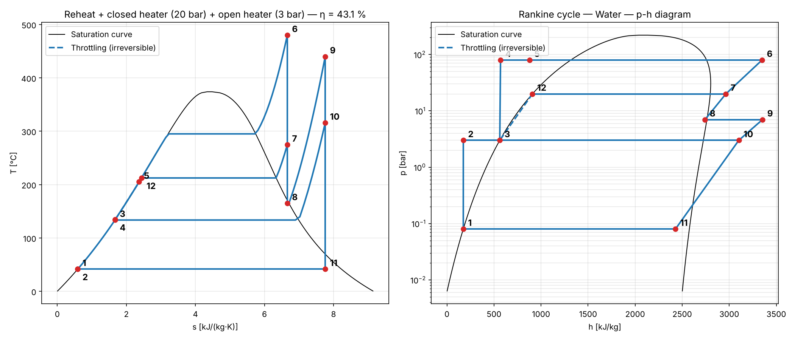

## Validazione

Ogni modulo è verificato da test automatici (72 test) sugli esempi svolti del Moran & Shapiro, *Fundamentals of Engineering Thermodynamics*. Gli scarti restano sotto l'1–2 % e dipendono dalle proprietà dei fluidi (CoolProp usa equazioni di stato di riferimento, il libro tabelle stampate).

**Ciclo Rankine** (8 MPa / 480 °C o vapore saturo, condensatore a 8 kPa)

| Esempio | Grandezza | Libro | Questo codice |
|---|---|---|---|
| 8.1 ideale, vapore saturo | rendimento | 37.1 % | 37.1 % |
| 8.1 ideale, vapore saturo | titolo uscita turbina | 0.6745 | 0.6749 |
| 8.2 η<sub>is</sub> = 0.85 | rendimento | 31.4 % | 31.4 % |
| 8.3 risurriscaldamento (7 bar → 440 °C) | rendimento | 40.3 % | 40.3 % |
| 8.4 risurriscaldamento, η<sub>t</sub> = 0.85 | rendimento | 35.1 % | 35.1 % |
| 8.5 rigeneratore aperto (7 bar), η<sub>t</sub> = 0.85 | rendimento | 36.9 % | 36.9 % |
| 8.5 rigeneratore aperto, 100 MW netti | portata di vapore | 3.69·10⁵ kg/h | 3.69·10⁵ kg/h |
| 8.6 risurriscaldamento + rigeneratore chiuso (20 bar) + aperto (3 bar) | rendimento | 43.1 % | 43.1 % |
| 8.6 stesso, 100 MW netti | portata di vapore | 2.8·10⁵ kg/h | 2.79·10⁵ kg/h |
| 8.6 stesso | frazioni spillate | 0.1522 / 0.0941 | 0.1496 / 0.0948 |

**Ciclo frigorifero** (R-134a, evaporatore a −10 °C, condensatore a 9 bar, 0.08 kg/s)

| Esempio | Grandezza | Libro | Questo codice |
|---|---|---|---|
| 10.1 ideale | COP | 4.57 | 4.58 |
| 10.1 ideale | potenza compressore | 2.48 kW | 2.50 kW |
| 10.1 ideale | potenza frigorifera | 11.34 kW | 11.43 kW |
| 10.2 η<sub>comp</sub> = 0.80 | COP | 3.66 | 3.66 |

**Ciclo Brayton** (aria, 100 kPa / 300 K, rapporto di compressione 10, ingresso turbina 1400 K)

| Esempio | Grandezza | Libro | Questo codice |
|---|---|---|---|
| 9.4 ideale | rendimento | 45.7 % | 45.7 % |
| 9.4 ideale | Back Work Ratio | 39.6 % | 39.6 % |
| 9.5 η<sub>c</sub> = η<sub>t</sub> = 0.80 | rendimento | 24.8 % | 24.9 % |
| 9.5 η<sub>c</sub> = η<sub>t</sub> = 0.80 | Back Work Ratio | 61.9 % | 61.9 % |
| 9.6 rigeneratore ε = 0.80 | rendimento | 56.8 % | 56.8 % |

**Ciclo combinato** (Esempio 9.12 — 45 MW; gas: rapporto di compressione 12, 1400 K, η<sub>c</sub> = 0.84, η<sub>t</sub> = 0.88, i fumi escono dall'HRSG a 400 K; vapore: 8 MPa / 400 °C, 8 kPa, η<sub>t</sub> = 0.90, η<sub>p</sub> = 0.80)

| Grandezza | Libro | Questo codice |
|---|---|---|
| portata d'aria | 100.87 kg/s | 100.8 kg/s |
| portata di vapore | 15.6 kg/s | 15.6 kg/s |

Il rendimento combinato risulta 52.7 %. Il codice trova anche un pinch point di soli 2.4 K: il progetto del libro è al limite della fattibilità (un HRSG reale richiede circa 8–15 K) e il programma lo segnala.

**Pompa di calore a CO₂ transcritica**: non c'è un esempio svolto nel libro, quindi la pressione ottimale del gas cooler è confrontata con la correlazione di Liao, Zhao & Jakobsen, *Applied Thermal Engineering* 20 (2000): p<sub>opt</sub> = (2.778 − 0.0157 t<sub>e</sub>) t<sub>gc</sub> + (0.381 t<sub>e</sub> − 9.34) [bar, °C].

| Evaporazione / uscita gas cooler | Correlazione di Liao | Questo codice |
|---|---|---|
| 0 °C / 35 °C | 87.9 bar | 87.4 bar |
| 0 °C / 40 °C | 101.8 bar | 101.3 bar |
| 0 °C / 45 °C | 115.7 bar | 115.9 bar |
| 0 °C / 50 °C | 129.6 bar | 131.5 bar |

L'analisi exergetica è verificata controllando che il bilancio exergetico si chiuda (exergia spesa = prodotto + distrutta) su ogni ciclo.

## Risultati di esempio

### Impianto a vapore: risurriscaldamento e rigenerazione

80 bar / 480 °C, condensatore a 0.08 bar, rendimenti isentropici 0.85:

| Configurazione | Rendimento | Lavoro netto [kJ/kg] | Titolo allo scarico | Vapore per 100 MW [kg/s] |
|---|---|---|---|---|
| Semplice | 33.7 % | 1067 | 0.874 | 93.7 |
| Risurriscaldamento (7 bar → 440 °C) | 35.1 % | 1293 | 0.996 | 77.4 |
| Rigeneratore aperto (7 bar) | 36.9 % | 975 | 0.864 | 102.6 |
| Risurriscaldamento + rigeneratore | 37.2 % | 1138 | 0.996 | 87.9 |

- Il ciclo semplice finisce con troppo liquido allo scarico della turbina (x = 0.874, sotto il limite pratico di 0.88–0.90): il **risurriscaldamento** risolve il problema e aumenta il lavoro per kg.
- La **rigenerazione** aumenta di più il rendimento, perché l'acqua entra in caldaia più calda; qui la pressione di spillamento migliore è circa 9 bar.

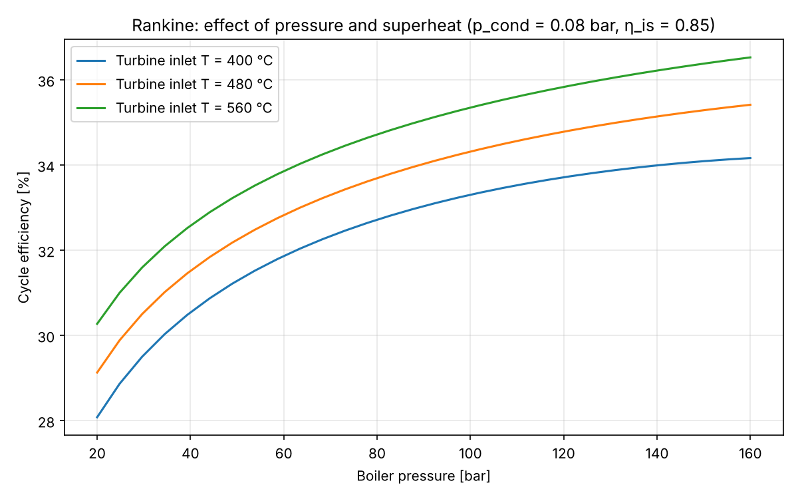
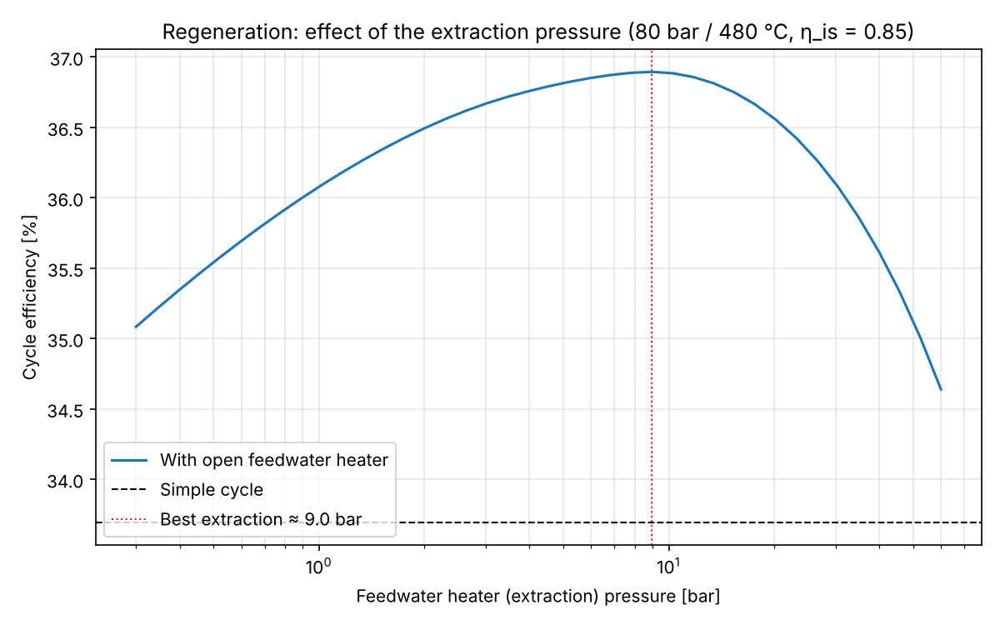

### Più rigeneratori (aperti e chiusi)

I grandi impianti a vapore spillano vapore dalla turbina a più pressioni per preriscaldare l'acqua di alimento. I rigeneratori chiusi sono scambiatori a fascio tubiero (l'acqua esce qualche kelvin, la *TTD*, sotto la temperatura di saturazione del vapore spillato, e la condensa viene laminata verso il rigeneratore successivo); quello aperto (degasatore) miscela le correnti.

165 bar / 540 °C, risurriscaldamento a 35 bar fino a 540 °C, condensatore a 0.07 bar, η<sub>t</sub> = 0.88, η<sub>p</sub> = 0.80, TTD = 3 K:

| Configurazione | Rendimento | Acqua in caldaia | Spillamento totale |
|---|---|---|---|
| Nessun rigeneratore | 39.9 % | 40 °C | 0 |
| 1 aperto (degasatore, 7 bar) | 43.2 % | 168 °C | 0.18 |
| 1 aperto + 1 chiuso AP | 43.9 % | 261 °C | 0.32 |
| 1 aperto + 2 chiusi AP | 44.5 % | 261 °C | 0.32 |
| 1 aperto + 2 AP + 2 BP chiusi | 45.7 % | 261 °C | 0.34 |
| 1 aperto + 3 AP + 3 BP chiusi | 46.2 % | 273 °C | 0.36 |

Ogni rigeneratore aggiunge un po' meno del precedente: gli impianti reali si fermano a 6–8, quando il guadagno di rendimento non ripaga più il costo dei componenti.

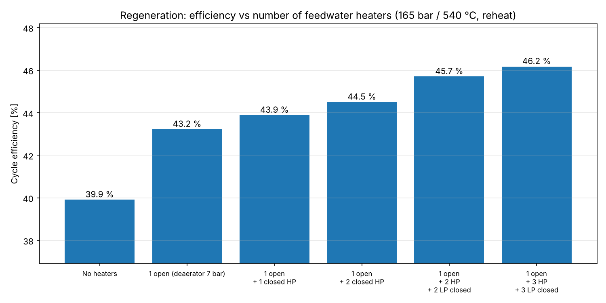

### Ciclo frigorifero e confronto tra refrigeranti

Frigorifero domestico / piccolo condizionatore: evaporatore a −10 °C, condensatore a 40 °C, surriscaldamento 5 K, sottoraffreddamento 3 K, rendimento del compressore 0.75.

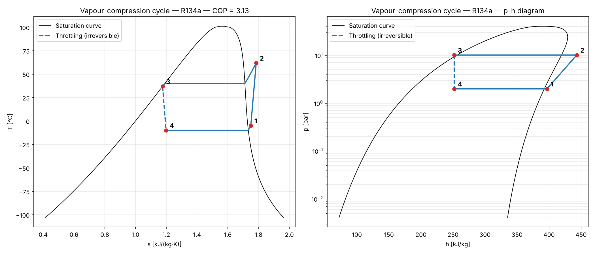

| Refrigerante | COP | Capacità vol. [kJ/m³] | p<sub>evap</sub> [bar] | p<sub>cond</sub> [bar] | T mandata [°C] |
|---|---|---|---|---|---|
| R134a | 3.13 | 1421 | 2.01 | 10.17 | 61.9 |
| R1234yf | 2.98 | 1354 | 2.22 | 10.18 | 49.7 |
| R290 (propano) | 3.09 | 2035 | 3.45 | 13.69 | 61.1 |
| R600a (isobutano) | 3.20 | 766 | 1.08 | 5.31 | 51.5 |
| R32 | 3.01 | 3837 | 5.83 | 24.78 | 103.7 |

- **R600a** ha il COP migliore ma la capacità volumetrica più bassa: serve un compressore grande, ed è per questo che si usa nei piccoli frigoriferi domestici.
- **R32** ha circa 2,7 volte la capacità volumetrica dell'R134a (compressore molto più piccolo), ma temperatura di mandata oltre 100 °C e pressioni di condensazione vicine a 25 bar.
- **R290** è un buon compromesso: COP simile all'R134a con circa il 40 % di capacità volumetrica in più, ed è un refrigerante naturale con GWP bassissimo, un'opzione chiave con la riduzione dei gas fluorurati nell'UE.
- **R1234yf** si comporta quasi come l'R134a (è nato come suo sostituto diretto) con un COP leggermente più basso.

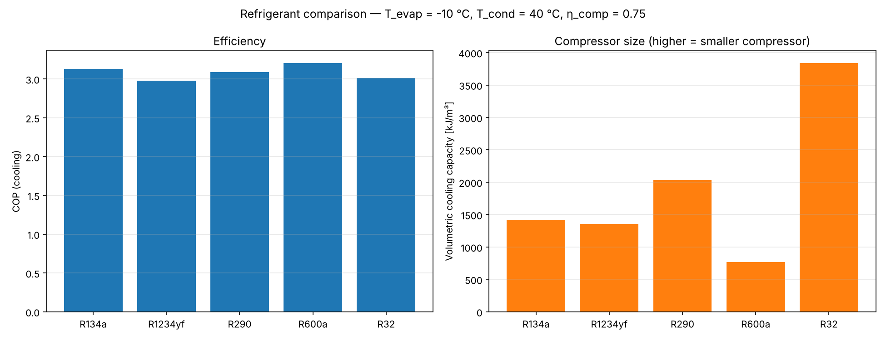
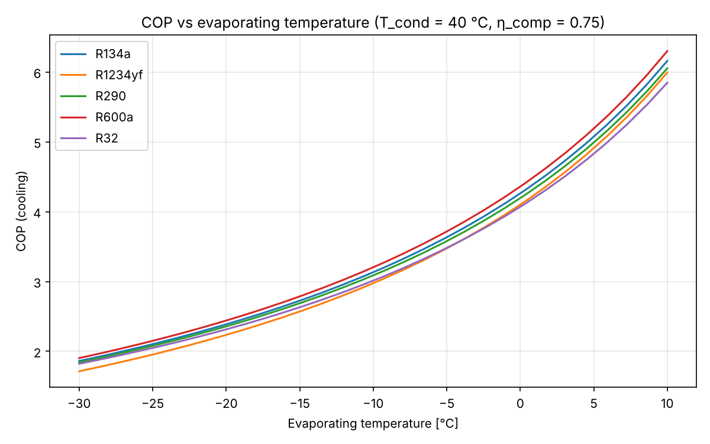

### Turbina a gas (Brayton)

Rapporto di compressione 10, ingresso turbina 1200 °C, aspirazione a 15 °C, η<sub>c</sub> = 0.86, η<sub>t</sub> = 0.89: rendimento **35.0 %** senza rigeneratore, **48.0 %** con un rigeneratore di efficacia 0.8 (scarico raffreddato da 633 °C a 385 °C). Per 50 MW servono circa 142 kg/s di aria.

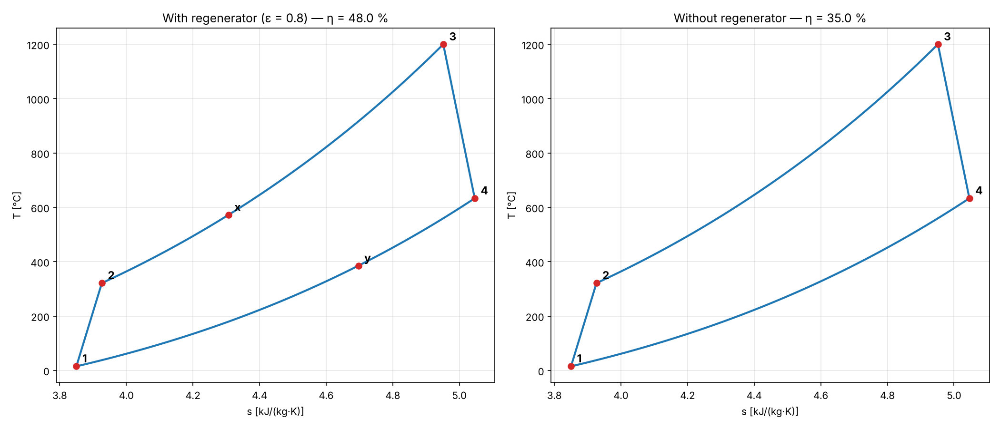

Senza rigenerazione il rendimento cresce sempre con il rapporto di compressione; **con la rigenerazione il massimo si ha a rapporti di compressione bassi**, perché lo scarico della turbina è più caldo e ha più calore da restituire all'aria compressa.

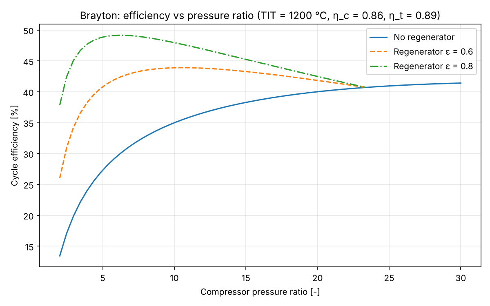

### Ciclo combinato (turbina a gas + vapore)

Turbina a gas con rapporto di compressione 18, ingresso turbina 1350 °C, aspirazione a 15 °C (η<sub>c</sub> = 0.88, η<sub>t</sub> = 0.90); HRSG a un livello di pressione a 40 bar / 520 °C con degasatore a 1.5 bar; camino a 170 °C:

| | Rendimento |
|---|---|
| Turbina a gas da sola | 41.9 % |
| Ciclo a vapore da solo | 36.9 % |
| **Ciclo combinato** | **58.0 %** |

I fumi della turbina a gas (610 °C) andrebbero sprecati in un impianto a ciclo semplice; qui producono 0.155 kg di vapore per kg di aria e il 28 % della potenza totale. Per 400 MW servono 640 kg/s di aria e 99 kg/s di vapore (289 MW dalla turbina a gas + 111 MW dalla turbina a vapore). Il pinch point è di 12.7 K.

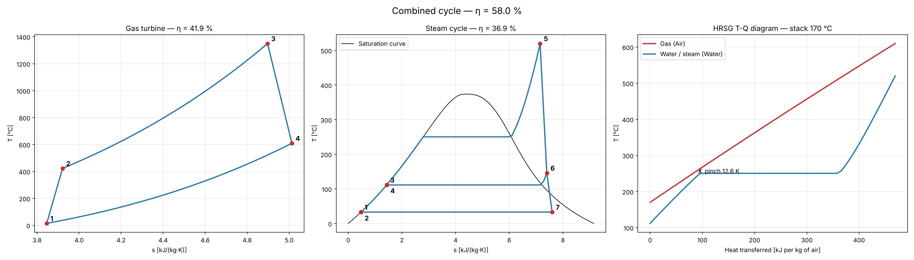

Con un HRSG a un solo livello di pressione, raffreddare di più i fumi recupera più calore, finché il pinch point non si chiude; pressioni del vapore più alte lo chiudono prima. Per questo gli impianti moderni usano HRSG a due o tre livelli di pressione.

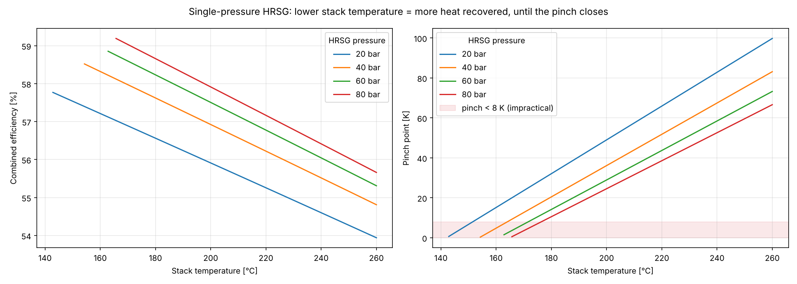

### Ciclo Rankine organico (ORC) per calore a bassa temperatura

Sorgente di calore a circa 150 °C, evaporazione a 120 °C (+5 K di surriscaldamento), condensazione a 35 °C, η<sub>t</sub> = 0.80, η<sub>p</sub> = 0.70:

| Fluido | p<sub>evap</sub> [bar] | p<sub>cond</sub> [bar] | Rendimento | Scarico turbina | Rapporto volumetrico | Portata volumetrica allo scarico [m³/s per MW] |
|---|---|---|---|---|---|---|
| R245fa | 19.30 | 2.120 | 13.0 % | surriscaldato (64 °C) | 10.6 | 3.0 |
| R1233zd(E) | 15.79 | 1.837 | 13.4 % | surriscaldato (62 °C) | 9.5 | 3.4 |
| Isopentano | 10.86 | 1.290 | 13.1 % | surriscaldato (78 °C) | 9.2 | 4.8 |
| n-Pentano | 9.07 | 0.977 | 13.3 % | surriscaldato (77 °C) | 9.9 | 6.0 |
| Toluene | 1.31 | 0.062 | 14.9 % | surriscaldato (66 °C) | 18.7 | 62.9 |
| Acqua | 1.99 | 0.056 | 16.2 % | umido (x = 0.891) | 24.8 | 54.0 |

Sulla carta l'acqua ha il rendimento più alto, ma condensa in vuoto spinto e richiede una **portata volumetrica allo scarico circa 18 volte quella dell'R245fa**: una turbina grande, multistadio e costosa. I fluidi organici permettono turbine piccole a un solo stadio, ed è per questo che gli impianti ORC si usano per sorgenti sotto i 300 °C circa. I fluidi "secchi" escono dalla turbina surriscaldati (niente gocce), e quel calore si recupera di solito con un recuperatore. L'R134a qui non si può usare: 120 °C sono oltre la sua temperatura critica.

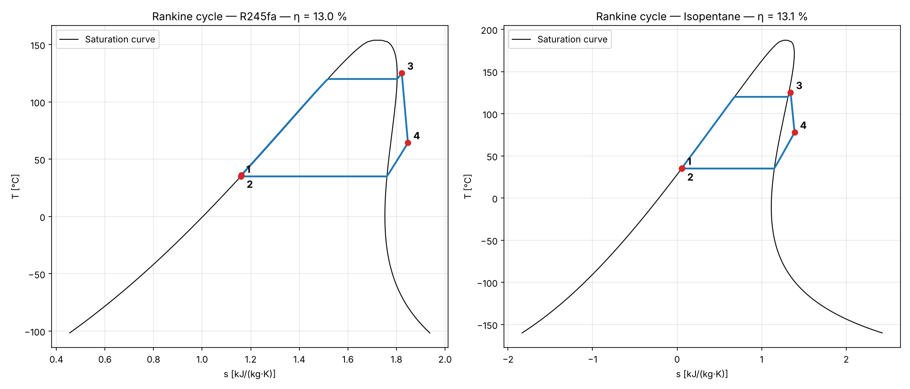

### Pompa di calore a CO₂ transcritica

La CO₂ (R744) è un refrigerante naturale con punto critico a soli 31 °C, quindi le pompe di calore che scaldano acqua cedono calore **sopra la pressione critica**, in un gas cooler senza condensazione. La pressione superiore diventa una libera scelta di progetto e il COP ha un massimo:

| Uscita gas cooler | Pressione ottimale | COP riscaldamento |
|---|---|---|
| 35 °C | 87.4 bar | 3.47 |
| 40 °C | 101.3 bar | 2.97 |
| 45 °C | 115.9 bar | 2.62 |
| 50 °C | 131.5 bar | 2.37 |

(evaporazione a 0 °C, surriscaldamento 5 K, rendimento del compressore 0.70). Più è fredda l'acqua che entra nel gas cooler, più alto è il COP: per questo le pompe di calore a CO₂ sono ottime per l'acqua calda sanitaria, scaldata da 10–15 °C.

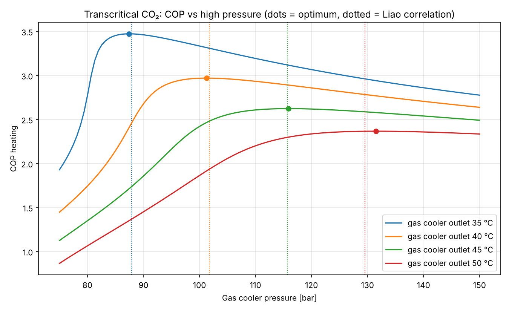
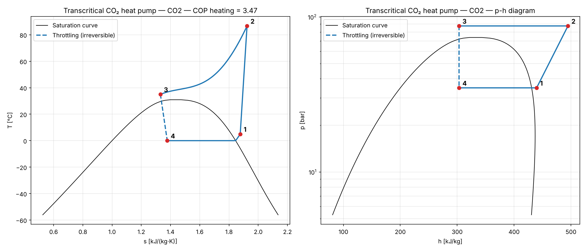

### Analisi exergetica: dove si perde il lavoro utile?

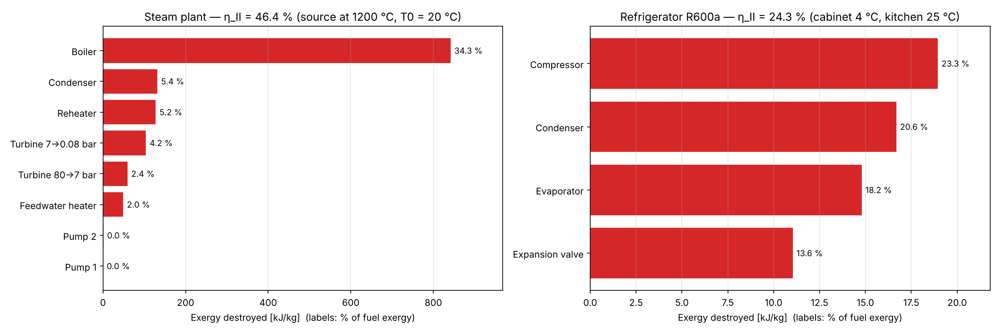

- Nell'impianto a vapore (fiamma a 1200 °C, ambiente a 20 °C) la **caldaia** distrugge circa un terzo dell'exergia del combustibile: il calore passa da una fiamma caldissima ad acqua che bolle a ~295 °C. È il motivo per cui i cicli combinati mettono una turbina a gas "sopra" il ciclo a vapore. Le turbine perdono molto meno, le pompe quasi niente.
- Nel frigorifero (cella a 4 °C, cucina a 25 °C) le perdite sono distribuite su tutti i componenti: compressore, i due scambiatori (differenze di temperatura finite) e la **valvola di laminazione**, che è una trasformazione puramente irreversibile.
- Nel ciclo combinato il rendimento di secondo principio sale al 67 %: il combustore resta la perdita maggiore (14 % dell'exergia del combustibile), ma i fumi caldi non vengono più buttati via.
- Nella pompa di calore a CO₂ la perdita maggiore è la **valvola di laminazione** (24 % del lavoro del compressore), perché lamina un fluido supercritico attraverso un salto di pressione molto grande. Per questo i sistemi a CO₂ più avanzati la sostituiscono con un eiettore o un espansore.

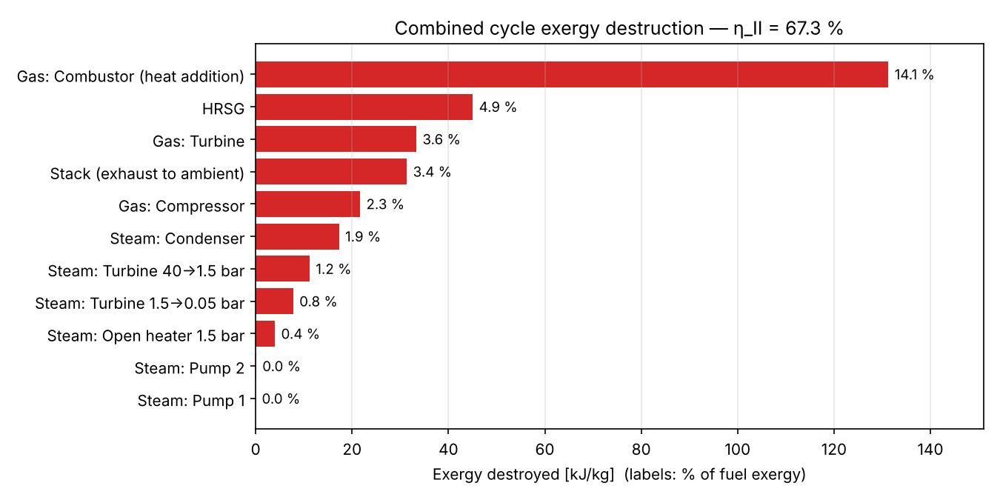

## Installazione

```bash
git clone https://github.com/Raffoo26/thermo-cycles.git
cd thermo-cycles
python3 -m venv .venv
source .venv/bin/activate        # Windows: .venv\Scripts\activate
pip install -r requirements.txt
```

Ogni volta che apri un nuovo Terminale, entra nella cartella e riattiva l'ambiente (`cd thermo-cycles` e `source .venv/bin/activate`).

## Usalo con i tuoi valori (senza scrivere codice)

```bash
python simulate.py
```

Il simulatore chiede quale ciclo vuoi (Rankine con qualsiasi numero di rigeneratori, frigorifero / pompa di calore, Brayton, ciclo combinato, pompa di calore a CO₂ transcritica), poi ogni valore con la sua **unità di misura** e un **valore predefinito** tra parentesi quadre. Premi Invio per tenere il predefinito, oppure scrivi il tuo valore. Esempio di sessione (il programma è in inglese):

```text
Which cycle do you want to simulate?
    1) Rankine cycle (steam power plant / ORC)
    2) Refrigeration / heat pump cycle
    3) Brayton cycle (gas turbine)
    4) Combined cycle (gas turbine + steam)
    5) Transcritical CO2 heat pump
  Choice [1]: 2

VAPOUR-COMPRESSION CYCLE (refrigerator / air conditioner / heat pump)
  Refrigerant [R134a]: R32
  Evaporating temperature [°C] [-10.0]: 7
  Condensing temperature [°C] [40.0]: 45
  Superheat at compressor inlet [K] [0.0]: 5
  Subcooling at condenser outlet [K] [0.0]: 3
  Compressor isentropic efficiency [0-1 or %] [1.0]: 70
  Cooling capacity [kW] [optional]: 3.5
```

Stampa la tabella degli stati e tutti i risultati, dimensiona l'impianto se hai indicato una potenza, se vuoi esegue l'analisi exergetica e salva i diagrammi T-s, p-h ed exergetico come immagini PNG nella cartella `results/`.

Consigli per l'inserimento:
- Decimali con il punto o con la virgola (`0.08` oppure `0,08`); rendimenti come frazione o in percentuale (`0.85` oppure `85`).
- I nomi dei fluidi sono quelli di [CoolProp](http://www.coolprop.org/fluid_properties/PurePseudoPure.html#list-of-fluids).
- I valori fisicamente impossibili (es. pressione al condensatore maggiore di quella in caldaia, o caldaia oltre la pressione critica) vengono rifiutati con una spiegazione.

## Web app

Un'app [Streamlit](https://streamlit.io/) con i campi per tutti e cinque i cicli (Rankine con fino a 4 rigeneratori, Brayton, ciclo combinato, frigorifero, CO₂ transcritica): cambia i valori, premi **Calculate** e ottieni diagrammi, tabelle degli stati, dimensionamento dell'impianto, analisi exergetica e download (PNG, CSV).

Per avviarla sul tuo computer:

```bash
pip install -r webapp/requirements.txt
streamlit run webapp/streamlit_app.py
```

Per pubblicarla online gratis su Streamlit Community Cloud:
1. Accedi a [share.streamlit.io](https://share.streamlit.io) con il tuo account GitHub.
2. **Create app** → *Deploy a public app from GitHub* → repository `Raffoo26/thermo-cycles`, branch `main`, file principale `webapp/streamlit_app.py`.
3. In **Advanced settings** scegli Python 3.12, poi **Deploy**. Ottieni un link pubblico da condividere.

## Usalo da Python

```python
from thermocycles import (FeedwaterHeater, rankine_reheat_regen_cycle, refrigeration_cycle,
                          brayton_cycle, combined_cycle, transcritical_heat_pump,
                          optimal_high_pressure, exergy_analysis)
from thermocycles.plots import plot_Ts, plot_ph, plot_exergy, plot_hrsg

plant = rankine_reheat_regen_cycle(p_high_bar=80, p_low_bar=0.08, T_max_C=480,
                                   p_reheat_bar=7, T_reheat_C=440,
                                   heaters=[FeedwaterHeater(20, "closed", ttd_K=3),
                                            FeedwaterHeater(3, "open")],
                                   eta_turbine=0.85, eta_pump=0.85)
plant.summary()                          # tabella degli stati e risultati
print(plant.extractions)                 # {20: y1, 3: y2}
plot_Ts(plant)

ex = exergy_analysis(plant, T0_C=20, T_source_C=1200)
ex.summary()
plot_exergy(ex)

hp = refrigeration_cycle(T_evap_C=-5, T_cond_C=45, superheat_K=5,
                         subcooling_K=3, eta_comp=0.75, fluid="R290")
print(hp.cop_heating)                    # COP come pompa di calore

gt = brayton_cycle(pressure_ratio=10, T_turbine_in_C=1200, T_in_C=15,
                   eta_comp=0.86, eta_turb=0.89, regen_effectiveness=0.8)
print(gt.efficiency)

cc = combined_cycle(brayton_cycle(18, 1350, T_in_C=15, eta_comp=0.88, eta_turb=0.90),
                    rankine_reheat_regen_cycle(40, 0.05, 520, eta_turbine=0.88, heaters=[1.5]),
                    T_stack_C=170)
print(cc.efficiency, cc.pinch_K)         # ≈ 0.58, ≈ 12.7 K
plot_hrsg(cc)

p_opt, co2 = optimal_high_pressure(T_evap_C=0, T_gc_out_C=35, superheat_K=5, eta_comp=0.7)
print(p_opt, co2.cop_heating)            # ≈ 87 bar, ≈ 3.5
```

Gli ingressi usano unità pratiche (bar, °C); tutti i risultati sono in unità SI (Pa, K, J/kg). Dividi per 1000 per avere kJ/kg, per 10<sup>5</sup> per avere bar, sottrai 273.15 per avere °C.

### Rankine — `rankine_cycle(...)` e `rankine_reheat_regen_cycle(...)`

| Parametro | Unità | Predefinito | Significato |
|---|---|---|---|
| `p_high_bar` | bar | obbligatorio | Pressione in caldaia (sotto la pressione critica) |
| `p_low_bar` | bar | obbligatorio | Pressione al condensatore |
| `T_max_C` | °C | `None` | Temperatura di ingresso turbina; `None` = vapore saturo secco |
| `p_reheat_bar` | bar | `None` | Pressione di risurriscaldamento; `None` = niente risurriscaldamento *(solo funzione avanzata)* |
| `T_reheat_C` | °C | = `T_max_C` | Temperatura dopo il risurriscaldamento *(solo funzione avanzata)* |
| `p_fwh_bar` | bar | `None` | Scorciatoia per un solo rigeneratore aperto a questa pressione *(solo funzione avanzata)* |
| `heaters` | – | `None` | Elenco dei rigeneratori *(solo funzione avanzata)*: `FeedwaterHeater(p_bar, kind, ttd_K)`, una tupla `(p_bar, kind, ttd_K)`, un dizionario o una pressione (= rigeneratore aperto). `kind` è `"open"` o `"closed"`; `ttd_K` [K] è la differenza terminale di temperatura dei rigeneratori chiusi (l'acqua esce a T<sub>sat</sub> − TTD). |
| `eta_turbine` | – | `1.0` | Rendimento isentropico di ogni tratto di turbina |
| `eta_pump` | – | `1.0` | Rendimento isentropico di ogni pompa |
| `fluid` | – | `"Water"` | Nome del fluido in CoolProp |

`rankine_cycle` è il ciclo semplice (stati 1–4). In `rankine_reheat_regen_cycle` gli stati sono numerati lungo la linea dell'acqua di alimento a partire dall'uscita del condensatore, poi l'uscita caldaia, l'espansione in turbina e infine le condense dei rigeneratori chiusi; `exhaust` indica lo stato di scarico della turbina. Le condense dei rigeneratori chiusi vengono laminate verso il rigeneratore a pressione inferiore (o il condensatore). Se uno spillamento e risurriscaldamento sono alla stessa pressione, il vapore viene spillato prima del risurriscaldatore. Le grandezze specifiche sono per kg di vapore che attraversa la caldaia.

| Risultato | Unità | Significato |
|---|---|---|
| `efficiency` | – | Rendimento l<sub>netto</sub> / q<sub>in</sub> |
| `w_turbine`, `w_pump`, `w_net` | J/kg | Lavoro di turbina, pompe e netto |
| `q_in`, `q_out` | J/kg | Calore in caldaia + risurriscaldatore / calore ceduto al condensatore |
| `bwr` | – | Back Work Ratio l<sub>pompe</sub> / l<sub>turbina</sub> |
| `extractions` | – | Dizionario {pressione di spillamento [bar]: frazione del vapore in caldaia spillata} |
| `extraction_fraction` | – | Frazione totale di vapore spillata verso i rigeneratori |
| `mass_flow_for_power(P)` | kg/s | Portata di vapore per una potenza netta `P` in **W** |

### Frigorifero / pompa di calore — `refrigeration_cycle(...)`

| Parametro | Unità | Predefinito | Significato |
|---|---|---|---|
| `T_evap_C` | °C | obbligatorio | Temperatura di evaporazione (saturazione) |
| `T_cond_C` | °C | obbligatorio | Temperatura di condensazione (saturazione), sotto quella critica |
| `superheat_K` | K | `0` | Surriscaldamento del vapore all'ingresso del compressore |
| `subcooling_K` | K | `0` | Sottoraffreddamento del liquido all'uscita del condensatore |
| `eta_comp` | – | `1.0` | Rendimento isentropico del compressore |
| `fluid` | – | `"R134a"` | Nome del refrigerante in CoolProp |

| Risultato | Unità | Significato |
|---|---|---|
| `cop_cooling`, `cop_heating` | – | COP come frigorifero / come pompa di calore |
| `cop_carnot_cooling` | – | COP di Carnot inverso tra temperatura di evaporazione e di condensazione |
| `w_comp`, `q_evap`, `q_cond` | J/kg | Lavoro del compressore, effetto frigorifero, calore al condensatore |
| `pressure_ratio` | – | Rapporto di compressione p<sub>cond</sub> / p<sub>evap</sub> |
| `discharge_temperature_C` | °C | Temperatura di mandata del compressore |
| `volumetric_capacity` | J/m³ | Effetto frigorifero per m³ di vapore aspirato dal compressore |
| `mass_flow_for_cooling(Q)` | kg/s | Portata di refrigerante per una potenza frigorifera `Q` in **W** |

### Brayton — `brayton_cycle(...)`

| Parametro | Unità | Predefinito | Significato |
|---|---|---|---|
| `pressure_ratio` | – | obbligatorio | Rapporto di compressione p<sub>2</sub>/p<sub>1</sub> |
| `T_turbine_in_C` | °C | obbligatorio | Temperatura di ingresso turbina |
| `T_in_C` | °C | `27` | Temperatura di aspirazione del compressore |
| `p_in_bar` | bar | `1.0` | Pressione di aspirazione del compressore |
| `eta_comp`, `eta_turb` | – | `1.0` | Rendimento isentropico di compressore / turbina |
| `regen_effectiveness` | – | `0` | Efficacia del rigeneratore (0 = assente, 1 = ideale) |
| `fluid` | – | `"Air"` | Nome del gas in CoolProp |

Risultati: `efficiency`, `w_comp`, `w_turb`, `w_net`, `q_in`, `q_out` [J/kg], `bwr`, `exhaust_temperature_C`, `mass_flow_for_power(P)`. Stati: 1 aspirazione compressore, 2 mandata compressore, x uscita rigeneratore, 3 ingresso turbina, 4 uscita turbina, y scarico.

### Ciclo combinato — `combined_cycle(gas, steam, T_stack_C)`

| Parametro | Unità | Predefinito | Significato |
|---|---|---|---|
| `gas` | – | obbligatorio | Risultato di `brayton_cycle(...)` (ciclo superiore) |
| `steam` | – | obbligatorio | Risultato di `rankine_cycle(...)` o `rankine_reheat_regen_cycle(...)`; tutto il calore di caldaia e risurriscaldatore viene dai fumi della turbina a gas |
| `T_stack_C` | °C | `100` | Temperatura dei fumi all'uscita dell'HRSG (camino) |

| Risultato | Unità | Significato |
|---|---|---|
| `efficiency` | – | Rendimento combinato (lavoro netto dei due cicli / calore nel combustore) |
| `w_net`, `q_in`, `q_hrsg` | J/kg aria | Lavoro netto, calore nel combustore, calore recuperato nell'HRSG |
| `steam_per_air` | kg/kg | Portata di vapore per kg di aria |
| `gas_share` | – | Frazione della potenza netta prodotta dalla turbina a gas |
| `pinch_K` | K | Minima differenza di temperatura fumi–acqua (dove l'acqua inizia a bollire) |
| `stack`, `gas`, `steam` | – | Stato al camino e risultati dei due cicli |
| `mass_flows_for_power(P)` | kg/s | Portate (aria, vapore) per una potenza netta totale `P` in **W** |

Il pinch point deve essere positivo (altrimenti un `ValueError` spiega come correggere il progetto); sotto 8 K viene aggiunto un avviso.

### Pompa di calore a CO₂ transcritica — `transcritical_heat_pump(...)` e `optimal_high_pressure(...)`

| Parametro | Unità | Predefinito | Significato |
|---|---|---|---|
| `T_evap_C` | °C | obbligatorio | Temperatura di evaporazione (sotto la temperatura critica) |
| `p_high_bar` | bar | obbligatorio | Pressione del gas cooler (sopra la pressione critica); non usato da `optimal_high_pressure` |
| `T_gc_out_C` | °C | obbligatorio | Temperatura di uscita dal gas cooler |
| `superheat_K` | K | `0` | Surriscaldamento all'aspirazione del compressore |
| `eta_comp` | – | `1.0` | Rendimento isentropico del compressore |
| `fluid` | – | `"CO2"` | Nome del fluido in CoolProp |

`optimal_high_pressure(T_evap_C, T_gc_out_C, superheat_K, eta_comp)` restituisce `(p_opt_bar, risultato)`. I risultati hanno gli stessi attributi di `refrigeration_cycle` (con `q_cond` = calore al gas cooler) più `cop_lorenz_heating` e `gas_cooler_mean_temperature`. Stati: 1 aspirazione compressore, 2 mandata compressore, 3 uscita gas cooler, 4 ingresso evaporatore.

### Exergia — `exergy_analysis(risultato, ...)`

| Parametro | Unità | Predefinito | Significato |
|---|---|---|---|
| `result` | – | obbligatorio | Il risultato di uno qualsiasi dei cicli |
| `T0_C` | °C | `25` | Temperatura ambiente (stato morto); il calore ceduto all'ambiente attraversa qui il confine |
| `T_source_C` | °C | `None` | Sorgente calda (fiamma, fumi, acqua calda); `None` = temperatura massima del fluido in ogni riscaldatore |
| `T_cold_C` | °C | `None` | Cella frigorifera; `None` = temperatura massima del fluido nell'evaporatore |
| `T_user_C` | °C | `None` | Pompe di calore: temperatura a cui il calore viene fornito (es. acqua calda); `None` = temperatura minima del fluido nel gas cooler |

Risultati: `destruction` (dizionario, J/kg per componente), `fuel`, `product`, `efficiency` (secondo principio), `table()`, `summary()`. Cicli motori e combinati: exergia spesa = exergia del calore della sorgente, prodotto = lavoro netto. Frigorifero: exergia spesa = lavoro del compressore, prodotto = exergia del freddo prodotto. Pompe di calore: exergia spesa = lavoro del compressore, prodotto = exergia del calore fornito (l'evaporatore preleva calore dall'ambiente a T0).

Funzioni di supporto: `saturation_pressure_bar(fluid, T_C)`, `saturation_temperature_C(fluid, p_bar)`, `critical_point(fluid)`. Ogni risultato ha anche `states`, `summary()`, `state_table()` e `warnings`.

## Esempi e test

```bash
python examples/rankine_example.py           # Rankine semplice + studio parametrico
python examples/rankine_advanced_example.py  # risurriscaldamento, rigenerazione, spillamento ottimale
python examples/refrigeration_example.py     # frigorifero + confronto refrigeranti
python examples/brayton_example.py           # turbina a gas con/senza rigeneratore
python examples/orc_example.py               # confronto fluidi per ORC
python examples/exergy_example.py            # exergia distrutta per componente
python examples/feedwater_heaters_example.py # rigeneratori aperti/chiusi, Moran 8.6, numero di rigeneratori
python examples/combined_cycle_example.py    # ciclo combinato, diagramma T-Q dell'HRSG, studio camino/pinch
python examples/co2_heat_pump_example.py     # CO₂ transcritica, pressione ottimale
pytest                                       # test di validazione e unitari
```

## Struttura del progetto

```text
thermocycles/      il pacchetto: core.py, rankine.py, refrigeration.py, brayton.py, combined.py,
                   transcritical.py, exergy.py, plots.py
simulate.py        simulatore interattivo da terminale
webapp/            web app Streamlit
notebooks/         notebook per Google Colab
examples/          script di esempio che generano le immagini in images/
tests/             test di validazione e unitari (pytest)
```

## Limiti dei modelli

Regime stazionario, nessuna perdita di carico negli scambiatori e nelle tubazioni, nessuna dispersione di calore verso l'ambiente, ciclo Brayton chiuso ad aria standard (niente chimica della combustione), HRSG a un solo livello di pressione, condense dei rigeneratori chiusi in cascata all'indietro (non pompate in avanti), compressione di vapore monostadio (niente scambiatore interno né eiettore). Sono le ipotesi standard di un corso di Fisica Tecnica.

## Roadmap

- [x] Ciclo Rankine semplice
- [x] Rankine con risurriscaldamento e rigenerazione
- [x] Ciclo frigorifero / pompa di calore a compressione di vapore con confronto tra refrigeranti
- [x] Ciclo Brayton (turbina a gas) con rigenerazione
- [x] Confronto fluidi per cicli ORC
- [x] Analisi exergetica
- [x] Simulatore interattivo, web app e notebook Colab
- [x] Ciclo combinato gas–vapore
- [x] Rigeneratori chiusi e spillamenti multipli
- [x] Pompa di calore a CO₂ transcritica

Idee per il futuro: HRSG a più livelli di pressione, cicli a vapore supercritici, pompa di calore a CO₂ con scambiatore interno o eiettore.

## Autore

Studente di Ingegneria Meccanica.

## Licenza

[MIT](LICENSE)
