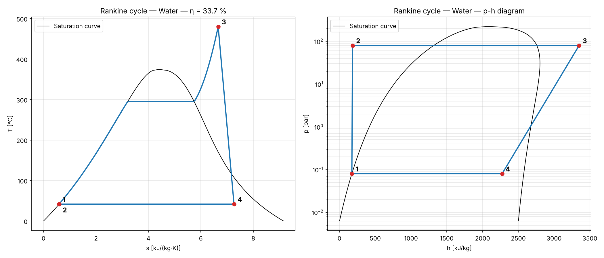

# Thermo Cycles

🇮🇹 [Versione italiana](README.it.md)

A Python simulator of thermodynamic power and refrigeration cycles using **real-fluid properties** ([CoolProp](http://www.coolprop.org/)). Built to put into practice what I study in Engineering Thermodynamics and Fluid Machinery courses.

## Features

- Solves the **Rankine cycle** (saturated or superheated steam, pump and turbine isentropic efficiencies): thermal efficiency, Back Work Ratio, mass flow for a given power output.
- Solves the **vapour-compression refrigeration / heat pump cycle** (superheat, subcooling, compressor isentropic efficiency): COP for cooling and heating, Carnot COP, second-law efficiency, pressure ratio, discharge temperature, volumetric cooling capacity.
- Compares **refrigerants** under the same operating conditions (R134a, R1234yf, R290, R600a, R32, ...).
- Plots **T-s** and **p-h** diagrams with the saturation dome and the real process paths.
- Runs **parametric studies** (e.g. efficiency versus boiler pressure and turbine inlet temperature).
- **Interactive simulator** (`simulate.py`): enter your own values with units and get results and diagrams, no coding needed.
- Works with any CoolProp fluid: water, but also organic fluids for ORC cycles (`R245fa`, `Toluene`, ...).



## Validation

Results are checked against worked textbook examples (Moran & Shapiro) by automated tests:

**Rankine cycle** (Examples 8.1 and 8.2 — 80 bar → 0.08 bar, saturated vapour)

| Quantity | Textbook | This code |
|---|---|---|
| Ideal cycle — thermal efficiency | 37.1 % | 37.1 % |
| Ideal cycle — turbine exhaust quality | 0.6745 | 0.6749 |
| η<sub>is</sub> = 0.85 — thermal efficiency | 31.4 % | 31.4 % |

**Refrigeration cycle** (Examples 10.1 and 10.2 — R-134a, −10 °C evaporator, 9 bar condenser, 0.08 kg/s)

| Quantity | Textbook | This code |
|---|---|---|
| Ideal cycle — COP | 4.57 | 4.58 |
| Ideal cycle — compressor power | 2.48 kW | 2.50 kW |
| Ideal cycle — cooling capacity | 11.34 kW | 11.43 kW |
| η<sub>comp</sub> = 0.80 — COP | 3.66 | 3.66 |

Small deviations (below 1 %) come from the property data: CoolProp uses reference equations of state (IAPWS-95 for water), the textbook uses printed tables.

## Example results

### Rankine cycle

Cycle at 80 bar / 480 °C, condenser at 0.08 bar, isentropic efficiencies of 0.85:
thermal efficiency **33.7 %**, net work **1067 kJ/kg**, mass flow for 100 MW net **93.7 kg/s**.
The turbine exhaust quality (x = 0.874) falls below the practical limit of 0.88–0.90: this is why real plants use reheat (next module).


### Refrigeration cycle and refrigerant comparison

Domestic refrigerator / small air conditioner conditions: evaporator at −10 °C, condenser at 40 °C, 5 K superheat, 3 K subcooling, compressor isentropic efficiency 0.75.


| Refrigerant | COP | Vol. capacity [kJ/m³] | p<sub>evap</sub> [bar] | p<sub>cond</sub> [bar] | Discharge T [°C] |
|---|---|---|---|---|---|
| R134a | 3.13 | 1421 | 2.01 | 10.17 | 61.9 |
| R1234yf | 2.98 | 1354 | 2.22 | 10.18 | 49.7 |
| R290 (propane) | 3.09 | 2035 | 3.45 | 13.69 | 61.1 |
| R600a (isobutane) | 3.20 | 766 | 1.08 | 5.31 | 51.5 |
| R32 | 3.01 | 3837 | 5.83 | 24.78 | 103.7 |

What the numbers show:
- **R600a** has the best COP but the lowest volumetric capacity: it needs a large compressor, which is why it is used in small domestic refrigerators.
- **R32** has about 2.7× the volumetric capacity of R134a (much smaller compressor) but a discharge temperature above 100 °C and condensing pressures near 25 bar.
- **R290** is a good compromise: COP close to R134a with about 40 % more volumetric capacity, and a natural refrigerant with very low GWP — a key option under the EU F-gas phase-down.
- **R1234yf** behaves almost like R134a (it was designed as a drop-in replacement) with a slightly lower COP.


## Installation

```bash
git clone https://github.com/Raffoo26/thermo-cycles.git
cd thermo-cycles
python3 -m venv .venv
source .venv/bin/activate        # Windows: .venv\Scripts\activate
pip install -r requirements.txt
```

## Run it with your own values (no coding needed)

From the project folder, with the virtual environment active:

```bash
python simulate.py
```

The simulator asks which cycle you want, then asks for every value with its **unit of measurement** and a **default** in square brackets. Press Enter to keep the default, or type your own value. Example session:

```text
Which cycle do you want to simulate?
    1) Rankine cycle (power plant)
    2) Refrigeration / heat pump cycle
  Choice [1]: 2

VAPOUR-COMPRESSION CYCLE (refrigerator / air conditioner / heat pump)
  Refrigerant [R134a]: R290
  Evaporating temperature [°C] [-10.0]: -5
  Condensing temperature [°C] [40.0]: 45
  Superheat at compressor inlet [K] [0.0]: 5
  Subcooling at condenser outlet [K] [0.0]: 3
  Compressor isentropic efficiency [0-1 or %] [1.0]: 75
  Cooling capacity [kW] [optional]: 3.5
```

It then prints the state table and all results, sizes the system if you gave a power or capacity (mass flow, compressor/turbine power, heat exchanged), and saves the T-s and p-h diagrams as PNG files in the `results/` folder.

Input tips:
- Decimals can be written with a point or a comma (`0.08` or `0,08`).
- Efficiencies can be written as a fraction or a percentage (`0.85` or `85`).
- Fluid names follow [CoolProp](http://www.coolprop.org/fluid_properties/PurePseudoPure.html#list-of-fluids): e.g. `Water`, `R134a`, `R1234yf`, `R290`, `R600a`, `R32`, `R410A`, `Ammonia`, `R245fa`, `Toluene`.
- Invalid inputs (e.g. condenser pressure higher than boiler pressure, or condensing above the critical temperature) are rejected with an explanation.

## Use it from Python

```python
from thermocycles import rankine_cycle, refrigeration_cycle
from thermocycles.plots import plot_Ts, plot_refrigeration_ph

r = rankine_cycle(p_high_bar=80, p_low_bar=0.08, T_max_C=480,
                  eta_turbine=0.85, eta_pump=0.85)
r.summary()                      # prints the state table and the results
print(r.efficiency)              # ≈ 0.337
plot_Ts(r)

hp = refrigeration_cycle(T_evap_C=-10, T_cond_C=40, superheat_K=5,
                         subcooling_K=3, eta_comp=0.75, fluid="R290")
print(hp.cop_heating)            # COP as a heat pump
plot_refrigeration_ph(hp)
```

### `rankine_cycle(...)` — input parameters

| Parameter | Unit | Default | Meaning |
|---|---|---|---|
| `p_high_bar` | bar | required | Boiler (maximum) pressure |
| `p_low_bar` | bar | required | Condenser (minimum) pressure |
| `T_max_C` | °C | `None` | Turbine inlet temperature; `None` = saturated vapour (no superheat) |
| `eta_turbine` | – | `1.0` | Turbine isentropic efficiency (1 = ideal) |
| `eta_pump` | – | `1.0` | Pump isentropic efficiency (1 = ideal) |
| `fluid` | – | `"Water"` | CoolProp fluid name |

### `rankine_cycle(...)` — results

| Attribute / method | Unit | Meaning |
|---|---|---|
| `efficiency` | – | Thermal efficiency w<sub>net</sub> / q<sub>in</sub> |
| `w_turbine`, `w_pump`, `w_net` | J/kg | Specific work of turbine, pump and net |
| `q_in`, `q_out` | J/kg | Heat supplied in the boiler / rejected in the condenser |
| `bwr` | – | Back Work Ratio w<sub>pump</sub> / w<sub>turbine</sub> |
| `mass_flow_for_power(P)` | kg/s | Mass flow for a net power `P` in **W** |
| `states["1"]` … `states["4"]` | SI | State points: `.p` [Pa], `.T` [K], `.h` [J/kg], `.s` [J/(kg·K)], `.x` [–] |
| `warnings` | – | List of warnings (e.g. low turbine exhaust quality) |

### `refrigeration_cycle(...)` — input parameters

| Parameter | Unit | Default | Meaning |
|---|---|---|---|
| `T_evap_C` | °C | required | Evaporating (saturation) temperature |
| `T_cond_C` | °C | required | Condensing (saturation) temperature |
| `superheat_K` | K | `0` | Vapour superheat at the compressor inlet |
| `subcooling_K` | K | `0` | Liquid subcooling at the condenser outlet |
| `eta_comp` | – | `1.0` | Compressor isentropic efficiency (1 = ideal) |
| `fluid` | – | `"R134a"` | CoolProp refrigerant name |

### `refrigeration_cycle(...)` — results

| Attribute / method | Unit | Meaning |
|---|---|---|
| `cop_cooling` | – | COP as a refrigerator / air conditioner q<sub>evap</sub> / w<sub>comp</sub> |
| `cop_heating` | – | COP as a heat pump q<sub>cond</sub> / w<sub>comp</sub> |
| `cop_carnot_cooling` | – | Reverse Carnot COP between evaporating and condensing temperatures |
| `w_comp`, `q_evap`, `q_cond` | J/kg | Compressor work, refrigerating effect, heat to condenser |
| `pressure_ratio` | – | p<sub>cond</sub> / p<sub>evap</sub> |
| `discharge_temperature_C` | °C | Compressor discharge temperature |
| `volumetric_capacity` | J/m³ | Cooling per m³ of vapour drawn in by the compressor |
| `mass_flow_for_cooling(Q)` | kg/s | Refrigerant mass flow for a cooling capacity `Q` in **W** |
| `states["1"]` … `states["4"]` | SI | State points (same attributes as above) |
| `warnings` | – | List of warnings (e.g. high discharge temperature) |

Inputs use practical units (bar, °C); all results are in SI units (Pa, K, J/kg). Divide by 1000 for kJ/kg, by 10<sup>5</sup> for bar, subtract 273.15 for °C.

## Examples and tests

```bash
python examples/rankine_example.py         # Rankine diagrams + parametric study
python examples/refrigeration_example.py   # refrigeration diagrams + refrigerant comparison
pytest                                     # validation and unit tests
```

## Roadmap

- [x] Simple Rankine cycle
- [ ] Rankine with reheat and regeneration
- [x] Vapour-compression refrigeration / heat pump cycle with refrigerant comparison
- [ ] Brayton cycle (gas turbine) with recuperation
- [ ] Working fluid comparison for ORC cycles
- [ ] Interactive web app

## Author

Mechanical Engineering student.

## License

[MIT](LICENSE)
