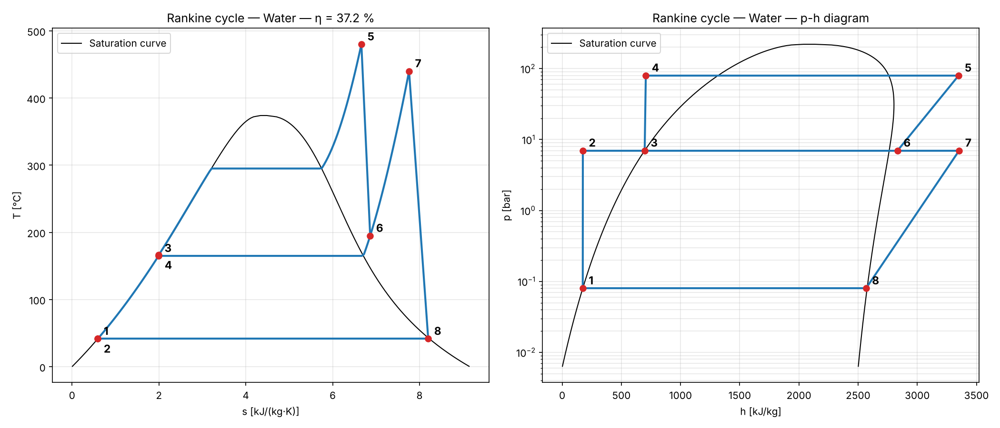
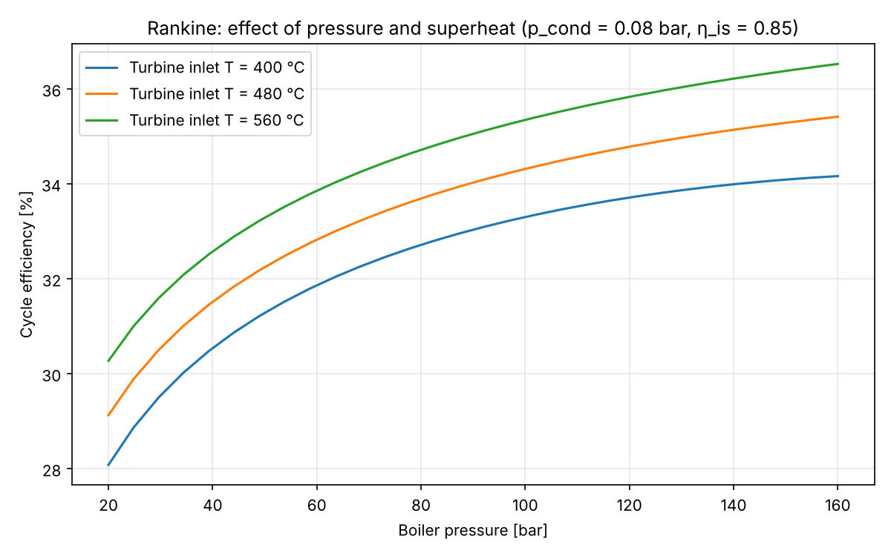
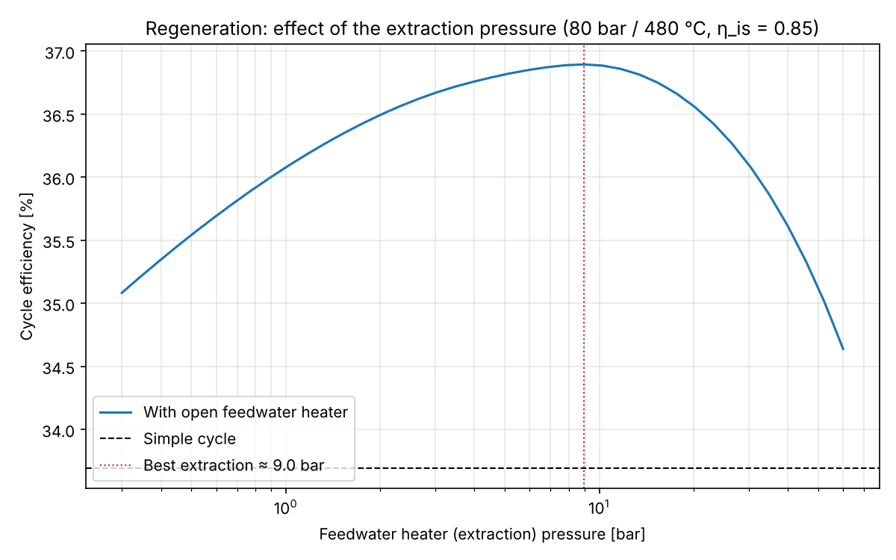
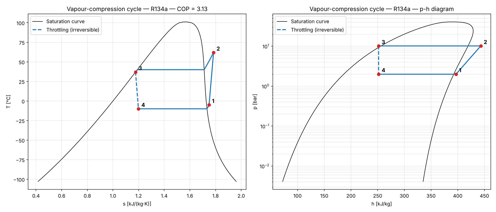
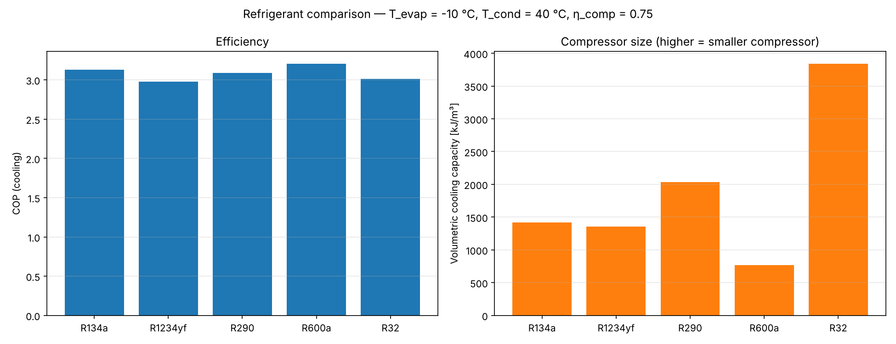
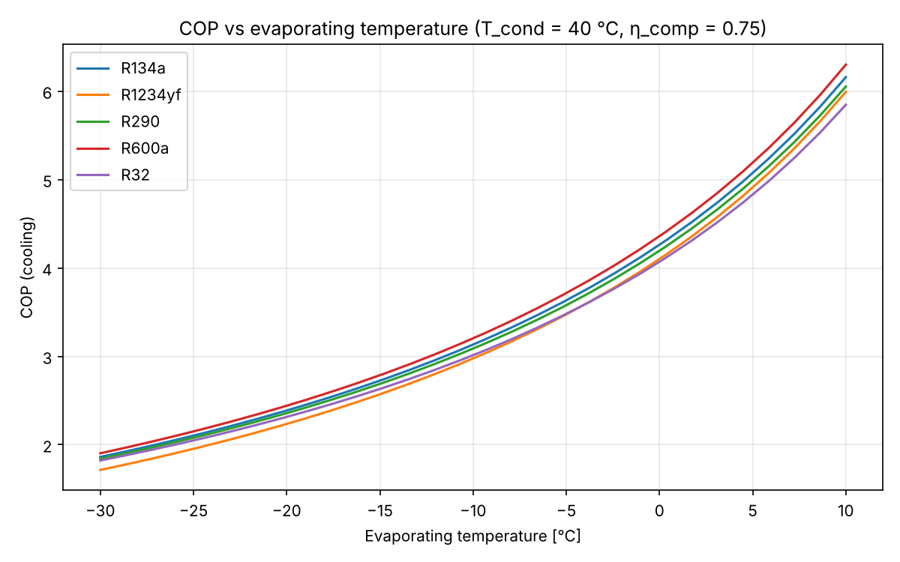
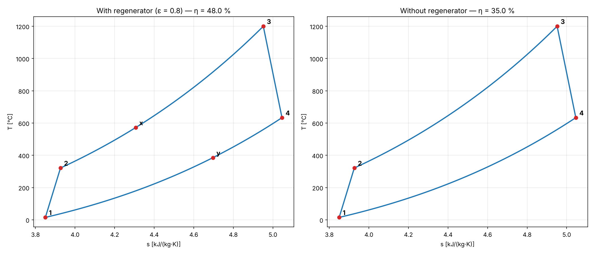
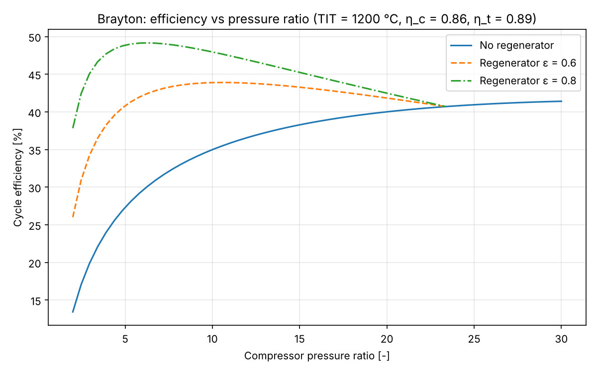
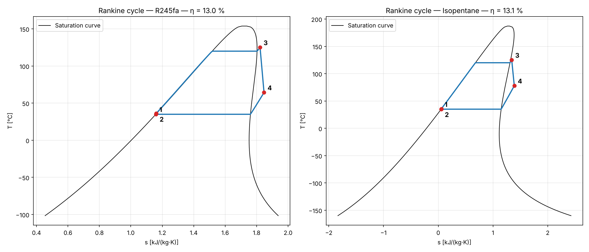
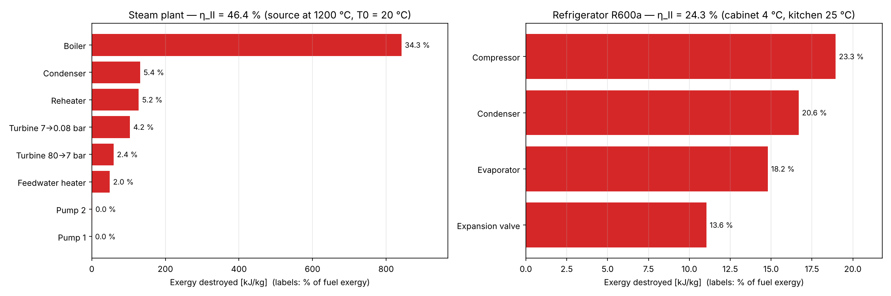

# Thermo Cycles

🇮🇹 [Versione italiana](README.it.md)

[](https://colab.research.google.com/github/Raffoo26/thermo-cycles/blob/main/notebooks/thermo_cycles_demo.ipynb)

A Python simulator of thermodynamic power and refrigeration cycles using **real-fluid properties** ([CoolProp](http://www.coolprop.org/)), with **exergy analysis**, an **interactive simulator**, a **web app** and a browser notebook. Built to put into practice what I study in Engineering Thermodynamics and Fluid Machinery courses. Every solver is **validated against worked textbook examples**.

## Try it without installing anything

- **Google Colab**: click the *Open in Colab* badge above, run the *Setup* cell, then change the values in the forms. Needs only a Google account.
- **Web app**: see [Web app](#web-app) to run it locally or publish it online.
- **On your computer**: see [Installation](#installation), then `python simulate.py`.

## Features

| Module | What it does |
|---|---|
| **Rankine cycle** | Simple, with **reheat**, with **regeneration** (open feedwater heater) or both. Steam plants and **ORC** with organic fluids. Efficiency, Back Work Ratio, extraction fraction, mass flow for a given power. |
| **Refrigeration / heat pump** | Vapour compression with superheat, subcooling and compressor efficiency. COP (cooling and heating), Carnot COP, pressure ratio, discharge temperature, volumetric capacity. |
| **Brayton cycle** | Gas turbine with real-gas air, compressor/turbine efficiencies and **regenerator**. |
| **Exergy analysis** | Exergy destroyed in every component (Gouy–Stodola) and second-law efficiency, for every cycle. |
| **Diagrams** | **T-s** and **p-h** diagrams with saturation dome and real process paths, exergy bar charts, parametric studies. |
| **Interfaces** | Interactive terminal simulator, Streamlit web app, Colab notebook, Python API. |

Works with any CoolProp fluid: water, refrigerants (R134a, R1234yf, R290, R600a, R32, R410A, ammonia…), organic fluids (R245fa, R1233zd(E), pentanes, toluene…) and gases (air, nitrogen, helium, CO₂).



## Validation

Every solver is checked by automated tests against worked examples of Moran & Shapiro, *Fundamentals of Engineering Thermodynamics*. Deviations stay below 1 % and come from the property data (CoolProp uses reference equations of state, the textbook uses printed tables).

**Rankine cycle** (8 MPa / 480 °C or saturated vapour, condenser 8 kPa)

| Example | Quantity | Textbook | This code |
|---|---|---|---|
| 8.1 ideal, saturated vapour | thermal efficiency | 37.1 % | 37.1 % |
| 8.1 ideal, saturated vapour | turbine exhaust quality | 0.6745 | 0.6749 |
| 8.2 η<sub>is</sub> = 0.85 | thermal efficiency | 31.4 % | 31.4 % |
| 8.3 reheat (7 bar → 440 °C) | thermal efficiency | 40.3 % | 40.3 % |
| 8.4 reheat, η<sub>t</sub> = 0.85 | thermal efficiency | 35.1 % | 35.1 % |
| 8.5 open feedwater heater (7 bar), η<sub>t</sub> = 0.85 | thermal efficiency | 36.9 % | 36.9 % |
| 8.5 open feedwater heater, 100 MW net | steam mass flow | 3.69·10⁵ kg/h | 3.69·10⁵ kg/h |

**Refrigeration cycle** (R-134a, −10 °C evaporator, 9 bar condenser, 0.08 kg/s)

| Example | Quantity | Textbook | This code |
|---|---|---|---|
| 10.1 ideal | COP | 4.57 | 4.58 |
| 10.1 ideal | compressor power | 2.48 kW | 2.50 kW |
| 10.1 ideal | cooling capacity | 11.34 kW | 11.43 kW |
| 10.2 η<sub>comp</sub> = 0.80 | COP | 3.66 | 3.66 |

**Brayton cycle** (air, 100 kPa / 300 K, pressure ratio 10, turbine inlet 1400 K)

| Example | Quantity | Textbook | This code |
|---|---|---|---|
| 9.4 ideal | thermal efficiency | 45.7 % | 45.7 % |
| 9.4 ideal | Back Work Ratio | 39.6 % | 39.6 % |
| 9.5 η<sub>c</sub> = η<sub>t</sub> = 0.80 | thermal efficiency | 24.8 % | 24.9 % |
| 9.5 η<sub>c</sub> = η<sub>t</sub> = 0.80 | Back Work Ratio | 61.9 % | 61.9 % |
| 9.6 regenerator ε = 0.80 | thermal efficiency | 56.8 % | 56.8 % |

The exergy analysis is checked by closing the exergy balance (fuel = product + destruction) on every cycle.

## Example results

### Steam power plant: reheat and regeneration

80 bar / 480 °C, condenser at 0.08 bar, isentropic efficiencies 0.85:

| Layout | Efficiency | Net work [kJ/kg] | Exhaust quality | Steam for 100 MW [kg/s] |
|---|---|---|---|---|
| Simple | 33.7 % | 1067 | 0.874 | 93.7 |
| Reheat (7 bar → 440 °C) | 35.1 % | 1293 | 0.996 | 77.4 |
| Open feedwater heater (7 bar) | 36.9 % | 975 | 0.864 | 102.6 |
| Reheat + open feedwater heater | 37.2 % | 1138 | 0.996 | 87.9 |

- The simple cycle ends with too much liquid at the turbine exhaust (x = 0.874, below the practical limit of 0.88–0.90): **reheat** fixes it and raises the net work per kg.
- **Regeneration** raises the efficiency most, because the water enters the boiler hotter; the best extraction pressure here is about 9 bar.




### Refrigeration cycle and refrigerant comparison

Domestic refrigerator / small air conditioner: evaporator at −10 °C, condenser at 40 °C, 5 K superheat, 3 K subcooling, compressor efficiency 0.75.



| Refrigerant | COP | Vol. capacity [kJ/m³] | p<sub>evap</sub> [bar] | p<sub>cond</sub> [bar] | Discharge T [°C] |
|---|---|---|---|---|---|
| R134a | 3.13 | 1421 | 2.01 | 10.17 | 61.9 |
| R1234yf | 2.98 | 1354 | 2.22 | 10.18 | 49.7 |
| R290 (propane) | 3.09 | 2035 | 3.45 | 13.69 | 61.1 |
| R600a (isobutane) | 3.20 | 766 | 1.08 | 5.31 | 51.5 |
| R32 | 3.01 | 3837 | 5.83 | 24.78 | 103.7 |

- **R600a** has the best COP but the lowest volumetric capacity: it needs a large compressor, which is why it is used in small domestic refrigerators.
- **R32** has about 2.7× the volumetric capacity of R134a (much smaller compressor) but a discharge temperature above 100 °C and condensing pressures near 25 bar.
- **R290** is a good compromise: COP close to R134a with about 40 % more volumetric capacity, and a natural refrigerant with very low GWP — a key option under the EU F-gas phase-down.
- **R1234yf** behaves almost like R134a (it was designed as a drop-in replacement) with a slightly lower COP.




### Gas turbine (Brayton)

Pressure ratio 10, turbine inlet 1200 °C, intake at 15 °C, η<sub>c</sub> = 0.86, η<sub>t</sub> = 0.89: efficiency **35.0 %** without regenerator, **48.0 %** with a regenerator of effectiveness 0.8 (exhaust cooled from 633 °C to 385 °C). 50 MW need about 142 kg/s of air.



Without regeneration the efficiency keeps growing with the pressure ratio; **with regeneration it peaks at low pressure ratios**, because the hot turbine exhaust has more heat to give back to the compressed air.



### Organic Rankine Cycle (ORC) for low-temperature heat

Heat source at about 150 °C, evaporating at 120 °C (+5 K superheat), condensing at 35 °C, η<sub>t</sub> = 0.80, η<sub>p</sub> = 0.70:

| Fluid | p<sub>evap</sub> [bar] | p<sub>cond</sub> [bar] | Efficiency | Turbine exhaust | Volume ratio | Exhaust volume flow [m³/s per MW] |
|---|---|---|---|---|---|---|
| R245fa | 19.30 | 2.120 | 13.0 % | superheated (64 °C) | 10.6 | 3.0 |
| R1233zd(E) | 15.79 | 1.837 | 13.4 % | superheated (62 °C) | 9.5 | 3.4 |
| Isopentane | 10.86 | 1.290 | 13.1 % | superheated (78 °C) | 9.2 | 4.8 |
| n-Pentane | 9.07 | 0.977 | 13.3 % | superheated (77 °C) | 9.9 | 6.0 |
| Toluene | 1.31 | 0.062 | 14.9 % | superheated (66 °C) | 18.7 | 62.9 |
| Water | 1.99 | 0.056 | 16.2 % | wet (x = 0.891) | 24.8 | 54.0 |

Water has the highest efficiency on paper, but it condenses under deep vacuum and needs **about 18 times the exhaust volume flow** of R245fa: a large, multi-stage, expensive turbine. Organic fluids allow small single-stage turbines, which is why ORC plants are used for heat sources below about 300 °C. "Dry" fluids leave the turbine superheated (no droplets), and that heat is normally recovered with a recuperator. R134a cannot be used here: 120 °C is above its critical temperature.



### Exergy analysis: where is the useful work lost?



- In the steam plant (flame at 1200 °C, ambient 20 °C) the **boiler** destroys about a third of the fuel exergy: heat goes from a very hot flame to water boiling at ~295 °C. This is why combined cycles put a gas turbine on top of the steam cycle. The turbines lose much less, and the pumps almost nothing.
- In the refrigerator (cabinet 4 °C, kitchen 25 °C) the losses are spread over all components: compressor, the two heat exchangers (finite temperature differences) and the **expansion valve**, which is a purely irreversible process.

## Installation

```bash
git clone https://github.com/Raffoo26/thermo-cycles.git
cd thermo-cycles
python3 -m venv .venv
source .venv/bin/activate        # Windows: .venv\Scripts\activate
pip install -r requirements.txt
```

Every time you open a new terminal, enter the folder and activate the environment again (`cd thermo-cycles` and `source .venv/bin/activate`).

## Run it with your own values (no coding needed)

```bash
python simulate.py
```

The simulator asks which cycle you want (Rankine, refrigeration / heat pump, Brayton), then every value with its **unit of measurement** and a **default** in square brackets. Press Enter to keep the default, or type your own value. Example session:

```text
Which cycle do you want to simulate?
    1) Rankine cycle (steam power plant / ORC)
    2) Refrigeration / heat pump cycle
    3) Brayton cycle (gas turbine)
  Choice [1]: 2

VAPOUR-COMPRESSION CYCLE (refrigerator / air conditioner / heat pump)
  Refrigerant [R134a]: R32
  Evaporating temperature [°C] [-10.0]: 7
  Condensing temperature [°C] [40.0]: 45
  Superheat at compressor inlet [K] [0.0]: 5
  Subcooling at condenser outlet [K] [0.0]: 3
  Compressor isentropic efficiency [0-1 or %] [1.0]: 70
  Cooling capacity [kW] [optional]: 3.5
```

It prints the state table and all results, sizes the system if you gave a power or capacity, optionally runs the exergy analysis, and saves the T-s, p-h and exergy diagrams as PNG files in the `results/` folder.

Input tips:
- Decimals with a point or a comma (`0.08` or `0,08`); efficiencies as a fraction or a percentage (`0.85` or `85`).
- Fluid names follow [CoolProp](http://www.coolprop.org/fluid_properties/PurePseudoPure.html#list-of-fluids).
- Physically impossible inputs (e.g. condenser pressure above boiler pressure, or a boiler above the critical pressure) are rejected with an explanation.

## Web app

A [Streamlit](https://streamlit.io/) app with sliders and fields for every cycle, live diagrams, state tables, exergy analysis and downloads (PNG, CSV).

Run it locally:

```bash
pip install -r webapp/requirements.txt
streamlit run webapp/streamlit_app.py
```

Publish it online for free on Streamlit Community Cloud:
1. Sign in at [share.streamlit.io](https://share.streamlit.io) with your GitHub account.
2. **Create app** → *Deploy a public app from GitHub* → repository `Raffoo26/thermo-cycles`, branch `main`, main file `webapp/streamlit_app.py`.
3. In **Advanced settings** choose Python 3.12, then **Deploy**. You get a public link to share.

## Use it from Python

```python
from thermocycles import (rankine_reheat_regen_cycle, refrigeration_cycle,
                          brayton_cycle, exergy_analysis)
from thermocycles.plots import plot_Ts, plot_ph, plot_exergy

plant = rankine_reheat_regen_cycle(p_high_bar=80, p_low_bar=0.08, T_max_C=480,
                                   p_reheat_bar=7, T_reheat_C=440, p_fwh_bar=7,
                                   eta_turbine=0.85, eta_pump=0.85)
plant.summary()                          # state table and results
print(plant.efficiency)                  # ≈ 0.372
plot_Ts(plant)

ex = exergy_analysis(plant, T0_C=20, T_source_C=1200)
ex.summary()
plot_exergy(ex)

hp = refrigeration_cycle(T_evap_C=-5, T_cond_C=45, superheat_K=5,
                         subcooling_K=3, eta_comp=0.75, fluid="R290")
print(hp.cop_heating)                    # COP as a heat pump

gt = brayton_cycle(pressure_ratio=10, T_turbine_in_C=1200, T_in_C=15,
                   eta_comp=0.86, eta_turb=0.89, regen_effectiveness=0.8)
print(gt.efficiency)
```

Inputs use practical units (bar, °C); all results are in SI units (Pa, K, J/kg). Divide by 1000 for kJ/kg, by 10<sup>5</sup> for bar, subtract 273.15 for °C.

### Rankine — `rankine_cycle(...)` and `rankine_reheat_regen_cycle(...)`

| Parameter | Unit | Default | Meaning |
|---|---|---|---|
| `p_high_bar` | bar | required | Boiler pressure (must be below the critical pressure) |
| `p_low_bar` | bar | required | Condenser pressure |
| `T_max_C` | °C | `None` | Turbine inlet temperature; `None` = saturated vapour |
| `p_reheat_bar` | bar | `None` | Reheat pressure; `None` = no reheat *(advanced function only)* |
| `T_reheat_C` | °C | = `T_max_C` | Temperature after reheat *(advanced function only)* |
| `p_fwh_bar` | bar | `None` | Open feedwater heater (extraction) pressure; `None` = no regeneration *(advanced function only)* |
| `eta_turbine` | – | `1.0` | Isentropic efficiency of every turbine section |
| `eta_pump` | – | `1.0` | Isentropic efficiency of every pump |
| `fluid` | – | `"Water"` | CoolProp fluid name |

`rankine_cycle` is the simple cycle (states 1–4). In `rankine_reheat_regen_cycle` states are numbered in flow order from the condenser outlet; if extraction and reheat pressures are equal, steam is bled before the reheater. Specific quantities are per kg of steam through the boiler.

| Result | Unit | Meaning |
|---|---|---|
| `efficiency` | – | Thermal efficiency w<sub>net</sub> / q<sub>in</sub> |
| `w_turbine`, `w_pump`, `w_net` | J/kg | Turbine, pump and net work |
| `q_in`, `q_out` | J/kg | Heat in boiler + reheater / heat rejected in the condenser |
| `bwr` | – | Back Work Ratio w<sub>pump</sub> / w<sub>turbine</sub> |
| `extraction_fraction` | – | Fraction of steam bled to the feedwater heater |
| `mass_flow_for_power(P)` | kg/s | Steam mass flow for a net power `P` in **W** |

### Refrigeration / heat pump — `refrigeration_cycle(...)`

| Parameter | Unit | Default | Meaning |
|---|---|---|---|
| `T_evap_C` | °C | required | Evaporating (saturation) temperature |
| `T_cond_C` | °C | required | Condensing (saturation) temperature, below the critical one |
| `superheat_K` | K | `0` | Vapour superheat at the compressor inlet |
| `subcooling_K` | K | `0` | Liquid subcooling at the condenser outlet |
| `eta_comp` | – | `1.0` | Compressor isentropic efficiency |
| `fluid` | – | `"R134a"` | CoolProp refrigerant name |

| Result | Unit | Meaning |
|---|---|---|
| `cop_cooling`, `cop_heating` | – | COP as refrigerator / as heat pump |
| `cop_carnot_cooling` | – | Reverse Carnot COP between evaporating and condensing temperatures |
| `w_comp`, `q_evap`, `q_cond` | J/kg | Compressor work, refrigerating effect, heat to condenser |
| `pressure_ratio` | – | p<sub>cond</sub> / p<sub>evap</sub> |
| `discharge_temperature_C` | °C | Compressor discharge temperature |
| `volumetric_capacity` | J/m³ | Cooling per m³ of vapour drawn in by the compressor |
| `mass_flow_for_cooling(Q)` | kg/s | Refrigerant mass flow for a cooling capacity `Q` in **W** |

### Brayton — `brayton_cycle(...)`

| Parameter | Unit | Default | Meaning |
|---|---|---|---|
| `pressure_ratio` | – | required | Compressor pressure ratio p<sub>2</sub>/p<sub>1</sub> |
| `T_turbine_in_C` | °C | required | Turbine inlet temperature |
| `T_in_C` | °C | `27` | Compressor inlet temperature |
| `p_in_bar` | bar | `1.0` | Compressor inlet pressure |
| `eta_comp`, `eta_turb` | – | `1.0` | Compressor / turbine isentropic efficiency |
| `regen_effectiveness` | – | `0` | Regenerator effectiveness (0 = none, 1 = ideal) |
| `fluid` | – | `"Air"` | CoolProp gas name |

Results: `efficiency`, `w_comp`, `w_turb`, `w_net`, `q_in`, `q_out` [J/kg], `bwr`, `exhaust_temperature_C`, `mass_flow_for_power(P)`. States: 1 compressor inlet, 2 compressor outlet, x regenerator outlet, 3 turbine inlet, 4 turbine outlet, y exhaust.

### Exergy — `exergy_analysis(result, ...)`

| Parameter | Unit | Default | Meaning |
|---|---|---|---|
| `result` | – | required | Any cycle result above |
| `T0_C` | °C | `25` | Ambient (dead state) temperature; heat to the ambient crosses the boundary here |
| `T_source_C` | °C | `None` | Hot source (flame, flue gas, hot water); `None` = highest fluid temperature of each heater |
| `T_cold_C` | °C | `None` | Refrigerated space; `None` = highest fluid temperature in the evaporator |

Results: `destruction` (dict, J/kg per component), `fuel`, `product`, `efficiency` (second-law), `table()`, `summary()`. Power cycles: fuel = exergy of the heat from the source, product = net work. Refrigeration: fuel = compressor work, product = exergy of the cold produced.

Helpers: `saturation_pressure_bar(fluid, T_C)`, `saturation_temperature_C(fluid, p_bar)`, `critical_point(fluid)`. Every result also has `states`, `summary()`, `state_table()` and `warnings`.

## Examples and tests

```bash
python examples/rankine_example.py           # simple Rankine + parametric study
python examples/rankine_advanced_example.py  # reheat, regeneration, best extraction pressure
python examples/refrigeration_example.py     # refrigeration + refrigerant comparison
python examples/brayton_example.py           # gas turbine with/without regenerator
python examples/orc_example.py               # ORC working-fluid comparison
python examples/exergy_example.py            # exergy destruction per component
pytest                                       # validation and unit tests
```

## Project structure

```text
thermocycles/      the package: core.py, rankine.py, refrigeration.py, brayton.py, exergy.py, plots.py
simulate.py        interactive terminal simulator
webapp/            Streamlit web app
notebooks/         Google Colab notebook
examples/          example scripts that produce the images in images/
tests/             validation and unit tests (pytest)
```

## Limits of the models

Steady state, no pressure drops in heat exchangers and piping, no heat losses to the environment, single-stage subcritical vapour compression (no transcritical CO₂), closed air-standard Brayton cycle (no combustion chemistry). These are the standard assumptions of an engineering thermodynamics course.

## Roadmap

- [x] Simple Rankine cycle
- [x] Rankine with reheat and regeneration
- [x] Vapour-compression refrigeration / heat pump cycle with refrigerant comparison
- [x] Brayton cycle (gas turbine) with regeneration
- [x] Working fluid comparison for ORC cycles
- [x] Exergy analysis
- [x] Interactive simulator, web app and Colab notebook
- [ ] Combined gas–steam cycle
- [ ] Closed feedwater heaters and multiple extractions
- [ ] Transcritical CO₂ heat pump

## Author

Mechanical Engineering student.

## License

[MIT](LICENSE)
